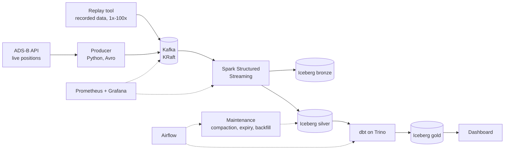

# flight-lakehouse: Build Plan

A real-time lakehouse that ingests live aircraft position data from open ADS-B feeds, lands it in Apache Iceberg, and serves analytics such as airport congestion, route delays and holding patterns. Built entirely on open source technologies.

## Goals

- Show hands-on Spark, Kafka and Iceberg work, which my CV does not yet prove.
- Produce measured numbers (throughput, latency, query time) rather than tool lists.
- Put architecture trade-offs on paper as short decision records.
- Be the flagship public data engineering repo on my GitHub: one command to run, a clear README, a dashboard screenshot.

## Non-goals

- **No cloud bill.** Everything runs locally in Docker Compose. Terraform and Kubernetes are optional extras.
- **No production claims.** This is project experience and is listed that way on the CV.
- **No proprietary or source-available components** where an open source one exists.
- **No secrets in the repo.** API credentials for the data source live in an ignored `.env`.

## Why this project

| CV gap | How this project closes it |
|---|---|
| No Spark, Kafka or streaming depth | Kafka ingestion and Spark Structured Streaming are the core path |
| No open table format | Iceberg tables with compaction, snapshot expiry and schema evolution |
| Little recent evidence of scale | Replay tool and benchmark at 100x speed, with published numbers |
| No architecture trade-offs on paper | Decision records in `docs/decisions/` |
| Thin public GitHub | A runnable, documented, pinned repo |

It also reuses what the CV already proves: Airflow, dbt, idempotency, medallion layering, testing and CI.

## Architecture



## Tech stack

| Layer | Choice | Why |
|---|---|---|
| Language and packaging | Python 3.12, `uv` | Same tooling as my other projects |
| Ingestion | Apache Kafka (KRaft mode), Avro, Apicurio Registry | Kafka is the top streaming keyword; the registry shows schema contracts |
| Processing | Spark Structured Streaming (PySpark) | Spark is the most requested skill I lack |
| Storage | Apache Iceberg on SeaweedFS (S3 API) | The open table format most engines support; SeaweedFS is Apache-licensed and maintained ([decision](docs/decisions/0001-object-store.md)) |
| Catalog | Apache Polaris (Iceberg REST) | Vendor-neutral, and links to my Snowflake experience |
| Query and transform | Trino with dbt (`dbt-trino`) | Reuses my dbt strength on a new engine |
| Orchestration | Airflow 3 | Compaction, snapshot expiry, backfills and dbt runs |
| Quality | dbt tests, schema compatibility checks in the registry | Extends my reliability story to streaming |
| Observability | Prometheus and Grafana | Consumer lag, freshness, throughput |
| Serving | Superset or Evidence | A dashboard screenshot is what recruiters see |
| Infra and CI | Docker Compose, GitHub Actions; optional Terraform and kind | One `make up` to run everything |

## Repo layout

```
flight-lakehouse/
├─ src/flight_lakehouse/
│  ├─ producer/         # API client, Avro serialisation, Kafka producer
│  ├─ replay/           # re-emit recorded data at 1x to 100x speed
│  ├─ streaming/        # Spark jobs: bronze and silver
│  ├─ maintenance/      # compaction, snapshot expiry, backfill
│  └─ cli.py            # flight-lakehouse produce | replay | stream | maintain
├─ schemas/             # Avro schemas, versioned
├─ dbt/                 # gold models and tests (dbt-trino)
├─ dags/                # Airflow DAGs
├─ infra/
│  ├─ compose/          # docker-compose files and service config
│  ├─ grafana/          # dashboards as code
│  └─ terraform/        # optional
├─ docs/
│  ├─ decisions/        # short decision records
│  └─ benchmarks.md     # method and results
├─ tests/
│  └─ fixtures/         # recorded API responses and sample events
├─ .github/workflows/
│  └─ ci.yml            # lint, unit tests, small end-to-end run
├─ Makefile             # make up | down | test | demo | benchmark
├─ .env.example
├─ PLAN.md
└─ README.md
```

## Data source

**Decided: adsb.lol** as the primary source, with OpenSky as an optional second producer ([decision record](docs/decisions/0002-data-source.md)). Data is under ODbL: attribute adsb.lol in the README and keep committed recordings under ODbL.

| Source | Notes |
|---|---|
| OpenSky Network | Optional second producer. OAuth2, 4,000 credits per day, research-oriented terms |
| adsb.lol | **Chosen.** Community ADS-B data under ODbL, no account needed today, dynamic rate limits, yearly history dumps for replay |
| Wikimedia EventStreams | Fallback if neither aviation source fits. Reliable public stream, different domain |

The replay tool removes the dependency on a live API: record a few hours once, then replay deterministically for tests, demos and benchmarks.

## Data model

**Kafka topic `flight.positions.v1`** (Avro, keyed by `icao24`)
- `icao24`, `callsign`, `origin_country`
- `event_time`, `received_at`
- `longitude`, `latitude`, `baro_altitude`, `geo_altitude`
- `velocity`, `true_track`, `vertical_rate`, `on_ground`, `squawk`

**Bronze `bronze.flight_positions`**
- Raw events as received, plus Kafka metadata (`topic`, `partition`, `offset`, `ingested_at`)
- Append-only, partitioned by ingestion day

**Silver `silver.flight_positions`**
- Deduplicated on (`icao24`, `event_time`), typed and validated
- Late data handled with a watermark; invalid rows routed to `silver.rejected_positions` with a reason
- Partitioned by event day, with a spatial bucket if benchmarks justify it

**Silver `silver.flights`**
- One row per flight: positions sessionised by aircraft and time gap
- `flight_id`, `icao24`, `callsign`, `first_seen`, `last_seen`, `departure_airport`, `arrival_airport` (nearest-airport match)

**Gold (dbt)**
- `gold.airport_traffic_hourly`: arrivals, departures and aircraft on ground per airport and hour
- `gold.route_stats_daily`: flights, median duration and duration spread per route
- `gold.holding_patterns`: flights circling near an airport before landing
- `gold.pipeline_freshness`: end-to-end latency from `event_time` to gold

Reference data: an open airports dataset (such as OurAirports) loaded as a dbt seed.

## Phases

Each phase is roughly a weekend or two and ends with something that works on its own.

### Phase 0: Decisions and skeleton

- [x] Confirm the data source: adsb.lol ([decision record](docs/decisions/0002-data-source.md))
- [x] Choose the object store: SeaweedFS ([decision record](docs/decisions/0001-object-store.md))
- [x] Repo skeleton with `uv`, `ruff`, `pytest` and the CI workflow
- [ ] Compose stack: Kafka, schema registry, SeaweedFS, Polaris

**Done when:** `make up` starts the stack and a smoke test creates and reads an Iceberg table.

### Phase 1: Ingestion

- [ ] Avro schema v1 registered with a compatibility rule
- [ ] Producer: poll the API, serialise, publish keyed by aircraft
- [ ] Recorder and replay tool with a speed multiplier
- [ ] Tests using recorded responses, so no live API calls in CI

**Done when:** events flow into Kafka from both the live API and the replay tool, and two replays of the same recording produce identical topic contents.

### Phase 2: Streaming to Iceberg

- [ ] Spark job writing bronze with checkpointing
- [ ] Silver job: deduplication, watermark for late data, rejected-rows table
- [ ] Flight sessionisation into `silver.flights`
- [ ] Failure test: kill and restart the job mid-stream

**Done when:** after a kill and restart, silver has no lost and no duplicated events compared with the recording.

### Phase 3: Gold and orchestration

- [ ] Trino connected to the catalog
- [ ] dbt project: gold models, tests and the airports seed
- [ ] Airflow DAGs: dbt run, compaction, snapshot expiry, backfill
- [ ] Dashboard on the gold tables

**Done when:** a full backfill from bronze reproduces the same gold tables, and the dashboard shows live data.

### Phase 4: Reliability evidence

- [ ] Grafana dashboards: consumer lag, throughput, freshness
- [ ] Schema evolution demo: add a field as schema v2 without stopping the pipeline
- [ ] Benchmark at 100x replay: events per second, end-to-end latency, query time before and after compaction
- [ ] Write the method and results in `docs/benchmarks.md`

**Done when:** the README shows real, reproducible numbers and `make benchmark` regenerates them.

### Phase 5: Portfolio polish

- [ ] README with the architecture diagram, quick start, dashboard screenshot and benchmark results
- [ ] Decision records: Spark vs Flink, Iceberg vs Delta, partitioning strategy, catalog choice
- [ ] Make the repo public and pin it on my GitHub profile
- [ ] Add a Projects entry to the CV with the measured numbers
- [ ] LinkedIn post about the project

## What it adds to the CV

- **Projects section:** one entry with the numbers from Phase 4 and a link.
- **Skills:** Spark, Kafka, Iceberg and Trino become defensible keywords, listed as project experience.
- **Trade-offs:** the decision records answer "what did you decide and why" directly.

## Open decisions

| Decision | Options | Leaning |
|---|---|---|
| Data source | OpenSky, adsb.lol, Wikimedia EventStreams | **Decided: adsb.lol** ([0002](docs/decisions/0002-data-source.md)) |
| Object store | MinIO, SeaweedFS, Garage | **Decided: SeaweedFS** ([0001](docs/decisions/0001-object-store.md)) |
| Dashboard | Superset, Evidence | Evidence is lighter; Superset is better known |
| Repo visibility | Private first, public later | Public once Phase 1 works |
| Optional Kubernetes | kind with Terraform, or skip | Only after Phase 5 |

## Risks

| Risk | Mitigation |
|---|---|
| Data source changes its API, limits or terms | Replay tool makes the pipeline independent of the live API; fallback source listed |
| Stack too heavy for a laptop (about 12–16 GB RAM) | Compose profiles so services start in groups; small Spark and Trino configs |
| Scope creep across many tools | Each phase has a done criterion; optional items stay optional |
| Benchmarks on a laptop look small | Report the method and hardware honestly; focus on ratios (before and after compaction) |
| Component licence changes | Prefer Apache-licensed projects; record the choice in a decision record |

## Ideas for later

- Flink version of the streaming job, with a comparison against Spark.
- OpenLineage with Marquez for lineage.
- A small natural-language query agent over the gold tables, linking to my GenAI work.
- Deploy to a cloud free tier with Terraform.
