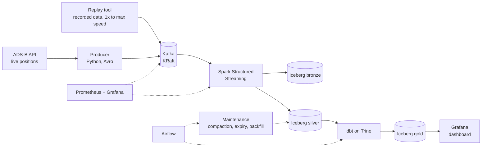

# flight-lakehouse: Build Plan

A real-time lakehouse that ingests live aircraft position data from open ADS-B feeds, lands it in Apache Iceberg, and serves analytics such as airport congestion, route delays and holding patterns. Built entirely on open source technologies.

## Goals

- Build a working streaming lakehouse end to end with Kafka, Spark and Iceberg.
- Produce measured numbers (throughput, latency, query time) rather than tool lists.
- Put architecture trade-offs on paper as short decision records.
- Make it easy to try: one command to run, a clear README, a dashboard screenshot.

## Non-goals

- **No cloud bill.** Everything runs locally in Docker Compose. Terraform and Kubernetes are optional extras.
- **No production claims.** This is a portfolio and learning project, not a production system.
- **No proprietary or source-available components** where an open source one exists.
- **No secrets in the repo.** API credentials for the data source live in an ignored `.env`.

## What it demonstrates

| Area | How |
|---|---|
| Streaming | Kafka ingestion and Spark Structured Streaming are the core path, with exactly-once writes |
| Open table format | Iceberg tables with compaction, snapshot expiry and schema evolution |
| Scale | Replay tool and max-speed benchmark, with published numbers |
| Architecture trade-offs | Decision records in `docs/decisions/` |
| Reliability | Idempotent replays, kill-and-restart tests, data validation and CI |

Batch tooling sits alongside it: Airflow, dbt, medallion layering and testing.

## Architecture



## Tech stack

| Layer | Choice | Why |
|---|---|---|
| Language and packaging | Python 3.12, `uv` | Fast, reproducible environments from one lock file |
| Ingestion | Apache Kafka (KRaft mode), Avro, Apicurio Registry | The standard streaming log; the registry enforces schema contracts |
| Processing | Spark Structured Streaming (PySpark) | Widely used, with first-class Kafka and Iceberg connectors |
| Storage | Apache Iceberg on SeaweedFS (S3 API) | The open table format most engines support; SeaweedFS is Apache-licensed and maintained ([decision](docs/decisions/0001-object-store.md)) |
| Catalog | Apache Polaris (Iceberg REST), state in Postgres | Vendor-neutral REST catalog, originally from Snowflake; Postgres keeps tables across restarts (Polaris's default is in memory) |
| Query and transform | Trino with dbt (`dbt-trino`) | SQL over Iceberg, with dbt for tested, versioned gold models |
| Orchestration | Airflow 3 | Compaction, snapshot expiry, backfills and dbt runs |
| Quality | dbt tests, schema compatibility checks in the registry | Catches bad data and breaking schema changes before they reach gold |
| Observability | Prometheus and Grafana | Consumer lag, freshness, throughput |
| Serving | Grafana on Trino ([decision](docs/decisions/0003-dashboard.md)) | The Grafana already used for observability also shows the gold tables, so there's no extra service |
| Infra and CI | Docker Compose, GitHub Actions; optional Terraform and kind | One `make up` to run everything |

## Repo layout

```
flight-lakehouse/
├─ src/flight_lakehouse/
│  ├─ producer/         # API client, Avro serialisation, Kafka producer
│  ├─ replay/           # re-emit recorded data at 1x up to max speed
│  ├─ streaming/        # Spark jobs: bronze and silver
│  ├─ maintenance/      # compaction, snapshot expiry, backfill
│  ├─ reference/        # builds reference extracts, such as airports
│  └─ cli.py            # flight-lakehouse produce | replay | stream | maintain | airports
├─ schemas/             # Avro schemas, versioned
├─ dbt/                 # gold models and tests (dbt-trino)
│  └─ seeds/            # reference data as CSV, such as airports
├─ dags/                # Airflow DAGs
├─ infra/
│  ├─ compose/          # docker-compose files and service config
│  ├─ grafana/          # dashboards as code
│  └─ terraform/        # optional
├─ docs/
│  ├─ decisions/        # short decision records
│  └─ benchmarks.md     # method and results
├─ tests/
│  └─ fixtures/         # recorded API responses and sample events
├─ .github/workflows/
│  └─ ci.yml            # lint, unit tests, small end-to-end run
├─ Makefile             # make up | down | test | demo | benchmark
├─ .env.example
├─ PLAN.md
└─ README.md
```

## Data source

**Decided: adsb.lol** as the primary source, with OpenSky as an optional second producer ([decision record](docs/decisions/0002-data-source.md)). Data is under ODbL: attribute adsb.lol in the README and keep committed recordings under ODbL.

| Source | Notes |
|---|---|
| OpenSky Network | Optional second producer. OAuth2, 4,000 credits per day, research-oriented terms |
| adsb.lol | **Chosen.** Community ADS-B data under ODbL, no account needed today, dynamic rate limits, yearly history dumps for replay |
| Wikimedia EventStreams | Fallback if neither aviation source fits. Reliable public stream, different domain |

The replay tool removes the dependency on a live API: record a few hours once, then replay deterministically for tests, demos and benchmarks.

## Scope and retention

Kept deliberately small so the project stays easy to run and maintain on a laptop.

- **Region:** a 100 nm (about 185 km) radius around Barcelona airport (LEBL, 41.297 N, 2.078 E). It covers Barcelona, Girona and Reus and their approaches.
- **Polling:** every 4 minutes. adsb.lol allows 500 requests per day (`x-ratelimit-limit: 500;w=86400`), and 4 minutes is 360 requests a day, which leaves margin for restarts and testing. The producer reads the rate-limit headers on every call and backs off when few requests remain.
- **Retention: 7 days** for the raw and cleaned data.
  - Kafka: `retention.ms` of 168 hours on `flight.positions.v1`.
  - Bronze and silver: a daily job deletes rows older than 7 days, then expires snapshots and removes orphan files so the storage is actually freed.
  - Gold: kept, because hourly and daily aggregates are tiny.

**Expected volume** (an estimate to check against real numbers in Phase 1; about 50 aircraft per poll were seen on a test call):

| | Per day | Kept (7 days) |
|---|---|---|
| Polls | 360 | 2,520 |
| Positions | ~25,000 (~50–150 aircraft per poll) | ~175,000 |
| Kafka (Avro) | ~3 MB | ~21 MB |
| Iceberg bronze and silver (Parquet) | ~1 MB | ~7 MB |

**What 4-minute polling means:**
- Live data gives one position per aircraft every 4 minutes. That is enough for airport traffic and route stats, but too coarse to see the shape of a holding pattern, so `gold.holding_patterns` is built and tested on replayed data from adsb.lol's full-resolution history dumps.
- Benchmarks don't depend on the live rate: the replay tool has a max-speed mode that publishes a recording as fast as Kafka accepts it, and the numbers are reported as events per second.

## Data model

**Kafka topic `flight.positions.v1`** (Avro, keyed by `icao24`)
Schema: [`schemas/flight_position.v1.avsc`](schemas/flight_position.v1.avsc), and [`v2`](schemas/flight_position.v2.avsc), which adds the optional `emergency` field; BACKWARD compatibility. SI units (metres, m/s) so another source such as OpenSky maps onto it directly.
- `icao24`, `callsign`, `registration`, `aircraft_type`, `category`, `source`
- `event_time`, `received_at`
- `longitude`, `latitude`, `baro_altitude`, `geo_altitude`
- `velocity`, `true_track`, `vertical_rate`, `on_ground`, `squawk`
- No `origin_country`: adsb.lol doesn't send it. It can be derived later from the `icao24` address block.

**Bronze `bronze.flight_positions`**
- Raw events as received, plus Kafka metadata (`topic`, `partition`, `offset`, `ingested_at`)
- Append-only, partitioned by ingestion day; rows older than 7 days are deleted

**Silver `silver.flight_positions`**
- Deduplicated on (`icao24`, `event_time`), typed and validated
- Late data handled with a watermark; invalid rows routed to `silver.rejected_positions` with a reason
- Partitioned by event day; rows older than 7 days are deleted

**Silver `silver.flights`**
- One row per flight: an aircraft's positions with no gap longer than 20 minutes (Spark session windows). A flight is written once the watermark passes its end, about 35 minutes after its last position
- `flight_id` (`icao24` plus first-seen time, so replays give the same ids), `icao24`, `callsign`, `registration`, `aircraft_type`, `first_seen`, `last_seen`, `duration_s`, `positions`, first and last position
- `departure_airport` and `arrival_airport`: the nearest airport within 25 km and 1,500 m above it, from the first and last position; null when the flight enters or leaves the area in cruise
- Known limit: an aircraft that lands and leaves again within 20 minutes, transponder on, shows as one flight
- Partitioned by `first_seen` day

**Gold (dbt)**
- `gold.airport_traffic_hourly`: arrivals, departures and aircraft on ground per airport and hour
- `gold.route_stats_daily`: flights, median duration and duration spread per route
- `gold.holding_patterns`: flights circling near an airport before landing
- `gold.pipeline_freshness`: end-to-end latency from `event_time` to gold
- `gold.active_flights`: aircraft in the air now with their latest position; a view over silver, so it is always current

**Reference data:** small, rarely changing tables kept as dbt seeds in `dbt/seeds/`, with their source documented in [`dbt/seeds/README.md`](dbt/seeds/README.md).
- `airports.csv`: an extract of [OurAirports](https://ourairports.com/data/) (public domain), with airports within the polling radius plus 20 nm. Rebuild it with `make airports` after changing the polling area, then commit the diff.
- dbt loads it as `reference.airports` and every consumer reads that table, including silver's airport matching.

## Phases

Each phase is roughly a weekend or two and ends with something that works on its own.

### Phase 0: Decisions and skeleton

- [x] Confirm the data source: adsb.lol ([decision record](docs/decisions/0002-data-source.md))
- [x] Choose the object store: SeaweedFS ([decision record](docs/decisions/0001-object-store.md))
- [x] Repo skeleton with `uv`, `ruff`, `pytest` and the CI workflow
- [x] Compose stack: Kafka, schema registry, SeaweedFS, Polaris

**Done when:** `make up` starts the stack and a smoke test creates and reads an Iceberg table.

### Phase 1: Ingestion

- [x] Avro schema v1 registered with a compatibility rule
- [x] Producer: poll the API, serialise, publish keyed by aircraft
- [x] Recorder and replay tool with a speed multiplier
- [x] Tests using recorded responses, so no live API calls in CI

**Done when:** events flow into Kafka from both the live API and the replay tool, and two replays of the same recording produce identical topic contents.

### Phase 2: Streaming to Iceberg

- [x] Spark job writing bronze with checkpointing
- [x] Silver job: deduplication, watermark for late data, rejected-rows table
- [x] Flight sessionisation into `silver.flights`
- [x] Failure test: kill and restart the job mid-stream (bronze and silver)

**Done when:** after a kill and restart, silver has no lost and no duplicated events compared with the recording.

### Phase 3: Gold and orchestration

- [x] Trino connected to the catalog
- [x] dbt project: gold models, tests and the airports seed
- [x] Airports seed as the `reference.airports` table, with dbt tests (unique code, coordinates in range, plausible elevation); silver reads the table instead of the CSV
- [x] Airflow DAGs: dbt run, compaction, 7-day retention with snapshot expiry, backfill
- [x] Grafana dashboard on the gold tables, through the Trino data source

**Done when:** a backfill from bronze reproduces the same gold tables for the retained 7 days, and the dashboard shows live data.

### Phase 4: Reliability evidence

- [x] Grafana dashboards: consumer lag, throughput, freshness
- [x] Schema evolution demo: add a field as schema v2 without stopping the pipeline (`make schema-demo`; schema v2 adds `emergency`, bronze decodes v1 and v2 side by side and the tables gain the column by Iceberg schema evolution; unit tested and checked against real spark-avro, not yet run on the full stack)
- [x] Benchmark with max-speed replay: events per second, end-to-end latency, query time before and after compaction (`make benchmark`, run on the 16 GB home server on 2026-11-22)
- [x] Write the method and results in `docs/benchmarks.md`

**Done when:** the README shows real, reproducible numbers and `make benchmark` regenerates them.

### Phase 5: Portfolio polish

- [ ] Before going public, replace the self-hosted runner deploy with a pull-based one (the home machine pulls `main` and redeploys on a schedule), then remove the runner. On a public repo, a fork's PR could run code on the runner's machine
- [ ] Make the repo public (decided: only after Phase 4 is done)
- [ ] README with the architecture diagram, quick start, dashboard screenshot and benchmark results
- [ ] Decision records: Spark vs Flink, Iceberg vs Delta, partitioning strategy, catalog choice

## Open decisions

| Decision | Options | Leaning |
|---|---|---|
| Data source | OpenSky, adsb.lol, Wikimedia EventStreams | **Decided: adsb.lol** ([0002](docs/decisions/0002-data-source.md)) |
| Object store | MinIO, SeaweedFS, Garage | **Decided: SeaweedFS** ([0001](docs/decisions/0001-object-store.md)) |
| Dashboard | Grafana, Superset, Evidence | **Decided: Grafana** ([0003](docs/decisions/0003-dashboard.md)) |
| Repo visibility | Private first, public later | **Decided: public once Phase 4 is done**, so the repo goes public with its benchmark numbers |
| Optional Kubernetes | kind with Terraform, or skip | Only after Phase 5 |

## Risks

| Risk | Mitigation |
|---|---|
| Data source changes its API, limits or terms | Replay tool makes the pipeline independent of the live API; fallback source listed |
| Stack too heavy for a laptop (about 12–16 GB RAM) | Compose profiles so services start in groups; small Spark and Trino configs |
| Scope creep across many tools | Each phase has a done criterion; optional items stay optional |
| Benchmarks on a laptop look small | Report the method and hardware honestly; focus on ratios (before and after compaction) |
| Component licence changes | Prefer Apache-licensed projects; record the choice in a decision record |

## Ideas for later

- Flink version of the streaming job, with a comparison against Spark.
- OpenLineage with Marquez for lineage.
- A small natural-language query agent over the gold tables.
- Deploy to a cloud free tier with Terraform.
