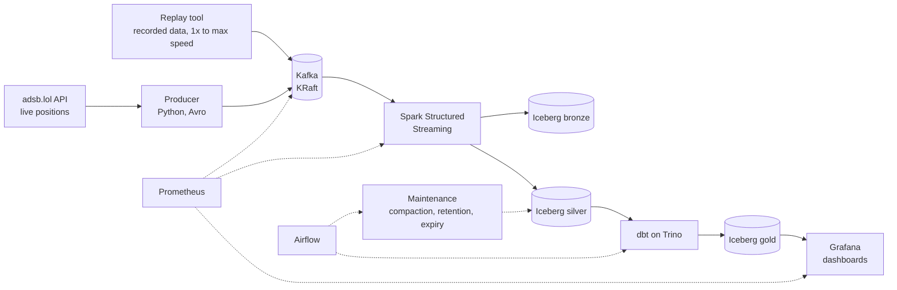

# flight-lakehouse

A real-time lakehouse for live aircraft positions from open ADS-B feeds: Kafka, Spark Structured Streaming, Apache Iceberg, Trino and dbt, all open source and running locally in Docker Compose.

It polls [adsb.lol](https://adsb.lol) every 4 minutes for aircraft within 100 nm of Barcelona airport, streams the positions through bronze and silver Iceberg tables, builds flights and airport statistics with dbt, and shows them in Grafana. A portfolio and learning project, not a production system: see [PLAN.md](PLAN.md) for the build plan.

## Architecture



- **Ingestion:** the producer publishes Avro events, keyed by aircraft, to `flight.positions.v1`. Apicurio Registry checks each schema version is backward compatible.
- **Bronze:** every event as received, with its Kafka metadata, written exactly once.
- **Silver:** validated positions deduplicated on (`icao24`, `event_time`) with a watermark, rejected rows with their reasons, and flights built with session windows.
- **Gold:** dbt models on Trino: airport traffic per hour, route statistics per day, holding patterns, pipeline freshness and the aircraft in the air now.
- **Storage and catalog:** Iceberg tables on SeaweedFS (S3 API), registered in Apache Polaris with its state in Postgres.
- **Operations:** Airflow builds gold every 15 minutes and runs the nightly maintenance; Grafana shows the gold tables and the streaming metrics.

## Results

Measured with `make benchmark` on a single 6-core, 16 GB machine. The method, hardware and limits are in [docs/benchmarks.md](docs/benchmarks.md).

| | |
|---|---|
| Max-speed replay into Kafka | 10,875 events/s |
| Bronze / silver throughput | 7,319 / 3,344 events/s |
| Latency, Kafka to bronze (p50 / p95) | 3.0 s / 4.1 s |
| Latency, Kafka to silver (p50 / p95) | 8.0 s / 9.2 s |
| Data files after compaction | 415 → 4 per table |
| Trino query time after compaction | 68–91% faster |

Reliability is tested, not assumed: the bronze and silver jobs are killed and restarted mid-stream with no lost or duplicated rows, and two replays of the same recording produce identical topic contents.

## Quick start

Requires Python 3.12, [uv](https://docs.astral.sh/uv/) and Docker. The whole stack needs about 12–16 GB of RAM; Compose profiles start it in parts.

```sh
make install   # install dependencies
make test      # unit tests, no Docker needed
make up        # Kafka, schema registry, SeaweedFS, Polaris
make deploy    # everything else: Trino, seeds, streaming, Airflow, Grafana
```

Then open Grafana at <http://localhost:3000> for the Flights, Pipeline freshness and Streaming dashboards. All ports are bound to `127.0.0.1`. The live producer needs no API key; `make replay` replays the recorded test data instead.

## All commands

`make help` lists every target.

```sh
make install   # install dependencies
make test      # run unit tests
make lint      # ruff checks
make check     # every quality check: lint, SQL lint (sqlfluff), duplication (jscpd), coverage, audit
make up        # start Kafka, Apicurio, SeaweedFS, Polaris and its Postgres
make smoke     # create, write and read an Iceberg table on the stack
make up-ui     # also start the web UIs (Kafka, schema registry, SeaweedFS)
make produce   # run the producer in this terminal instead (Ctrl+C to stop)
make replay    # replay the recorded test data into Kafka
make airports  # rebuild the airports seed for the polling area (see dbt/seeds/README.md)
make stream    # run the pipeline in the background: live producer (every 4 min) + Spark bronze and silver jobs
               # (silver's flights need reference.airports: run make trino && make dbt-seed once)
make stream-logs  # follow both; make stream-stop stops them
make test-stream  # Spark tests: bronze kill-and-restart, silver end to end (slow, ~1.5 min)
make trino     # start Trino on the Iceberg catalog (catalog lakehouse, port 8080)
make test-trino   # read and write Iceberg tables through Trino
make dbt-seed     # load and test only the reference tables, such as reference.airports
make dbt-build    # load reference.airports, build the gold tables and run the dbt tests (needs make trino)
make dbt-backfill # rebuild every gold bucket silver still holds (7 days)
make maintain     # run the Iceberg maintenance once: 7-day retention, compaction, snapshot expiry
make airflow      # start Airflow (port 8090): gold every 15 min, daily maintenance, backfill on demand
make test-dags    # check the Airflow DAGs parse
make grafana      # start Grafana (port 3000): Flights and Pipeline freshness on gold, through Trino,
                  # and Streaming (Kafka lag, throughput, freshness) from Prometheus (port 9090)
make schema-demo  # publish v1 then v2 events (schema v2 adds emergency) while the pipeline runs (needs make stream)
make benchmark    # max-speed replay benchmark; writes docs/benchmark-results.{json,md} (see docs/benchmarks.md; 16 GB+ RAM)
make deploy    # start or update the whole pipeline: Trino, seeds, streaming, Airflow, Grafana
make down      # stop the stack (data is kept in Docker volumes)
```

The home machine runs `make deploy` itself after each green push to `main`: see [infra/deploy/](infra/deploy/README.md).

## Design decisions

Short records of the main choices and their trade-offs, in [docs/decisions/](docs/decisions/):

| | Decision |
|---|---|
| [0001](docs/decisions/0001-object-store.md) | Object store: SeaweedFS, since MinIO's community edition is no longer maintained |
| [0002](docs/decisions/0002-data-source.md) | Data source: adsb.lol, with recordings for replay |
| [0003](docs/decisions/0003-dashboard.md) | Dashboard: Grafana on Trino, the same Grafana as the observability |
| [0004](docs/decisions/0004-stream-processor.md) | Stream processor: Spark Structured Streaming rather than Flink |
| [0005](docs/decisions/0005-table-format.md) | Table format: Iceberg rather than Delta Lake or Hudi |
| [0006](docs/decisions/0006-partitioning.md) | Partitioning: daily, hidden partitions on each table's retention column |
| [0007](docs/decisions/0007-catalog.md) | Catalog: Apache Polaris with its state in Postgres |

## Repository layout

```
src/flight_lakehouse/   producer, replay, Spark streaming jobs, maintenance, benchmark, CLI
schemas/                Avro schemas, versioned
dbt/                    gold models, tests and the airports seed
dags/                   Airflow DAGs
infra/                  Docker Compose, service config, Grafana dashboards, deploy timer
docs/                   decision records and benchmarks
tests/                  unit and integration tests, recorded API responses
```

## Data and attribution

Aircraft position data comes from [adsb.lol](https://adsb.lol) under the [Open Database License (ODbL)](https://opendatacommons.org/licenses/odbl/1-0/). Recorded samples in this repo and tables derived from them are available under the same licence.

Airport reference data comes from [OurAirports](https://ourairports.com/data/), which is in the public domain.

## Licence

The code is licensed under the [Apache License 2.0](LICENSE). Data recorded from adsb.lol stays under ODbL, as described above. To report a security issue, see [SECURITY.md](SECURITY.md).
